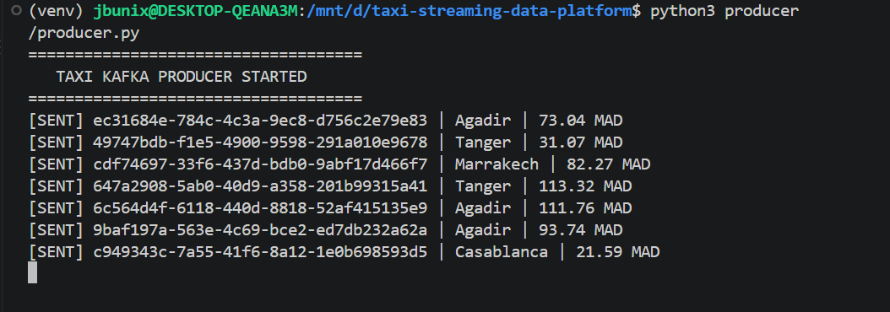
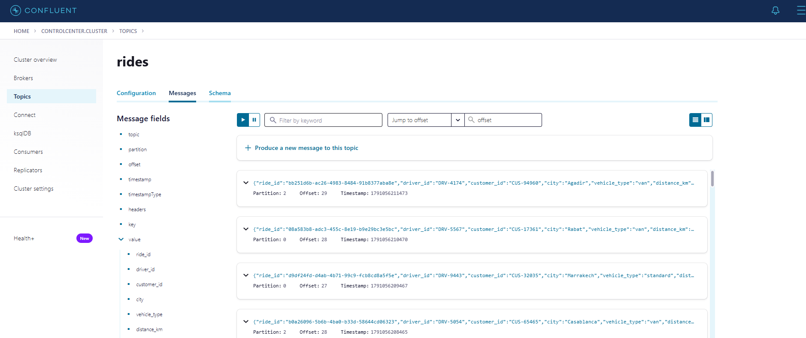
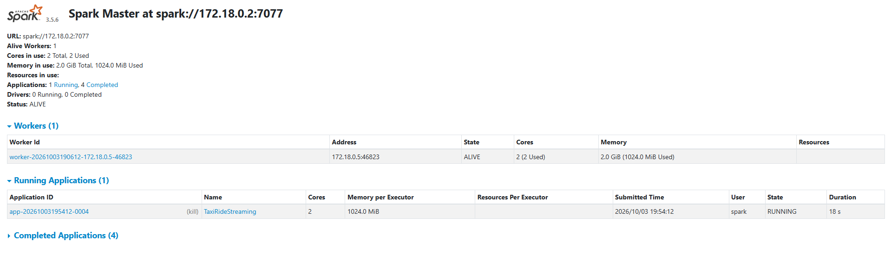
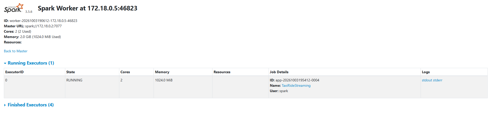
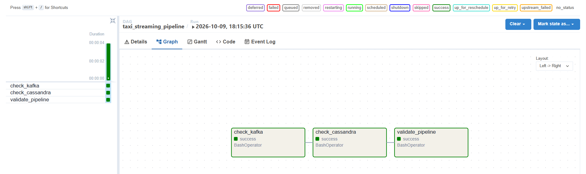
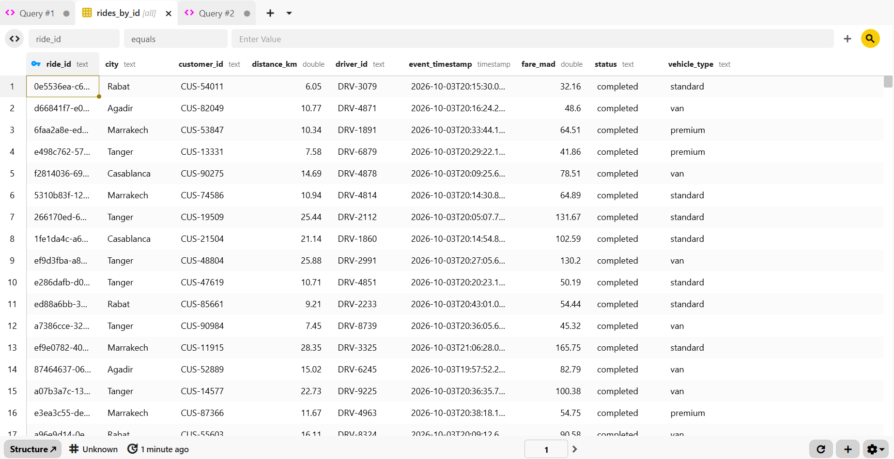
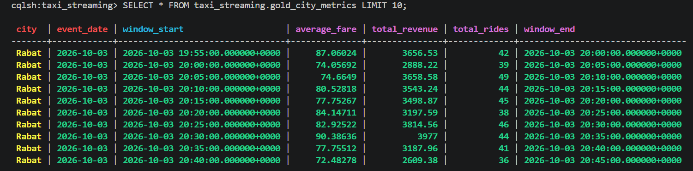

# Plateforme de streaming de courses de taxi

Projet Big Data de traitement d'événements de courses de taxi en temps réel. Les événements sont produits par Python, transportés par Kafka, traités par Spark Structured Streaming et stockés dans Cassandra.

Le projet met en œuvre :

- une architecture **Kappa** pour le traitement temps réel ;
- le modèle **Medallion** avec les niveaux Bronze, Silver et Gold ;
- Docker Compose pour lancer l'infrastructure ;
- Airflow pour vérifier et superviser les services ;
- PostgreSQL uniquement pour les métadonnées internes d'Airflow.

## Architecture

```text
Producer Python
      |
      v
Kafka - topic rides
      |
      v
Spark Structured Streaming
      |
      +--> Bronze : JSON brut reçu depuis Kafka
      |
      +--> Silver : validation, typage, filtrage et déduplication
      |        |
      |        v
      |   Cassandra - rides_by_id
      |
      +--> Gold : agrégations par ville et fenêtres de 5 minutes
               |
               v
          Cassandra - gold_city_metrics
```

## Pourquoi une architecture Kappa ?

L'architecture Kappa utilise un seul chemin de traitement streaming. Dans ce projet, les événements arrivent dans Kafka et sont traités par Spark Structured Streaming. Il n'existe pas de pipeline batch séparé qui recalculerait les résultats.

```text
Source d'événements -> Kafka -> Spark Streaming -> Cassandra
```

Airflow ne transforme pas cette architecture en Lambda. Il est utilisé pour l'orchestration et la validation de l'infrastructure, et non comme un deuxième moteur de traitement.

## Résultats de l'exécution

Les captures suivantes montrent les étapes essentielles du pipeline. Elles sont conservées dans `docs/screenshots/` afin que le README reste consultable après la suppression des captures de travail du dossier `Projet-Taxi/`.

### Producteur Python

Le producer génère continuellement des événements de courses et les envoie vers le topic Kafka `rides`.



### Messages Kafka

Kafka reçoit les événements produits par Python et les rend disponibles pour Spark Structured Streaming.



### Spark Master et Worker

Le Master coordonne l'application Spark et le Worker exécute les tâches de traitement.





### Validation Airflow

Le DAG Airflow valide la connectivité de Kafka, Cassandra, du Master Spark et du Worker Spark. Il ne remplace pas le job Spark Streaming.

Le graphe ci-dessous montre les trois tâches exécutées dans l'ordre :
`check_kafka`, `check_cassandra` et `validate_pipeline`.



### Résultats Cassandra dans Beekeeper Studio

Beekeeper Studio permet de consulter les résultats écrits par Spark dans Cassandra. La table Silver conserve les courses validées, tandis que la table Gold contient les métriques agrégées par ville et par fenêtre temporelle de cinq minutes.

#### Table Silver : `rides_by_id`



#### Table Gold : `gold_city_metrics`



## Organisation Medallion

### Bronze

Spark lit la valeur JSON du topic Kafka. Cette étape conserve la donnée reçue sous forme brute.

### Silver

Les événements sont convertis selon un schéma typé, puis filtrés :

- `event_timestamp` doit être valide ;
- `ride_id` doit exister ;
- `distance_km` doit être positif ;
- `fare_mad` doit être positif ;
- seuls les trajets `completed` sont conservés ;
- les doublons sont supprimés à partir de `ride_id` ;
- un watermark de 10 minutes est utilisé.

Les données Silver sont écrites dans Cassandra, table `rides_by_id`.

### Gold

Les trajets Silver sont regroupés par ville et par fenêtres de 5 minutes. Les indicateurs calculés sont :

- le nombre de courses ;
- le revenu total ;
- le tarif moyen.

Les résultats sont écrits dans Cassandra, table `gold_city_metrics`. Une ligne représente une ville et une fenêtre temporelle, et non une course individuelle.

## Technologies utilisées

| Technologie | Rôle |
|---|---|
| Python | Génération continue des événements taxi |
| Kafka | Transport et conservation temporaire des événements |
| Zookeeper | Coordination de Kafka dans cette configuration |
| Schema Registry | Service Confluent disponible pour la gestion des schémas |
| Control Center | Interface de supervision Kafka |
| Spark 3.5.6 | Traitement distribué et streaming |
| Cassandra 5.0 | Stockage NoSQL des données Silver et Gold |
| Airflow 2.10.5 | Orchestration et vérification des services |
| PostgreSQL 16 | Base de métadonnées d'Airflow |
| Docker Compose | Déploiement local des services |

## Prérequis

- Docker Desktop démarré avec l'intégration WSL activée ;
- Docker Compose ;
- Python 3 ;
- un terminal WSL/Linux ;
- le projet situé dans `/mnt/d/taxi-streaming-data-platform` ou dans un autre dossier local.

Vérifier Docker :

```bash
docker --version
docker compose version
```

## Démarrage de l'infrastructure

Depuis la racine du projet :

```bash
cd /mnt/d/taxi-streaming-data-platform
docker compose up -d
```

Vérifier l'état des conteneurs :

```bash
docker compose ps
```

Le conteneur `taxi-spark-checkpoints-init` peut apparaître comme terminé. C'est normal : il initialise les permissions du volume de checkpoints, puis s'arrête.

Si nécessaire, l'initialisation peut être relancée explicitement :

```bash
docker compose up --force-recreate spark-checkpoints-init
docker compose up -d spark-master spark-worker
```

## Création du topic Kafka

L'auto-création des topics est désactivée dans `docker-compose.yml`. Créer le topic `rides` une seule fois :

```bash
docker exec taxi-kafka kafka-topics \
  --create \
  --topic rides \
  --bootstrap-server kafka:29092 \
  --partitions 3 \
  --replication-factor 1
```

Si le topic existe déjà, Kafka affiche un message d'existence. Pour vérifier :

```bash
docker exec taxi-kafka kafka-topics \
  --bootstrap-server kafka:29092 \
  --list
```

## Initialisation de Cassandra

Exécuter le script CQL :

```bash
docker exec -i taxi-cassandra cqlsh < cassandra/init.cql
```

Ouvrir une session Cassandra :

```bash
docker exec -it taxi-cassandra cqlsh
```

Vérifier les tables :

```sql
USE taxi_streaming;
DESCRIBE TABLES;
SELECT COUNT(*) FROM rides_by_id;
SELECT COUNT(*) FROM gold_city_metrics;
```

L'avertissement concernant `COUNT(*)` sans clé de partition est attendu pour une démonstration, mais ce type de requête doit être évité sur de gros volumes.

## Lancement de Spark Streaming

Lancer le job depuis le conteneur Master :

```bash
docker exec -it taxi-spark-master \
  /opt/spark/bin/spark-submit \
  --master spark://spark-master:7077 \
  --deploy-mode client \
  --packages org.apache.spark:spark-sql-kafka-0-10_2.12:3.5.6,com.datastax.spark:spark-cassandra-connector_2.12:3.5.1 \
  --conf spark.cassandra.connection.host=cassandra \
  --conf spark.cassandra.connection.port=9042 \
  --conf spark.driver.host=spark-master \
  --conf spark.driver.bindAddress=0.0.0.0 \
  /opt/spark/jobs/ride_streaming.py
```

Ce terminal doit rester ouvert. Le job est continu et reste bloqué volontairement sur :

```python
spark.streams.awaitAnyTermination()
```

Lancer le producer dans un deuxième terminal :

```bash
cd /mnt/d/taxi-streaming-data-platform
python3 -m venv .producer-venv
source .producer-venv/bin/activate
python -m pip install -r producer/requirements.txt
python3 -u producer/producer.py
```

Le producer utilise `localhost:9092`, car il s'exécute sur l'hôte. Spark utilise `kafka:29092`, car il s'exécute dans le réseau Docker.

Sortie attendue :

```text
[SENT] <ride_id> | Rabat | <fare> MAD
```

## Vérification du pipeline

### Interfaces Web

| Service | URL |
|---|---|
| Airflow | http://localhost:8080 |
| Spark Master | http://localhost:8088 |
| Spark Worker | http://localhost:8089 |
| Confluent Control Center | http://localhost:9021 |
| Schema Registry | http://localhost:8081 |

Identifiants Airflow par défaut dans cette configuration :

```text
Utilisateur : admin
Mot de passe : admin
```

### Vérifier Spark

Dans l'interface Master, l'application `TaxiRideStreaming` doit apparaître dans `Running Applications`.

Dans l'interface Worker, un exécuteur doit apparaître dans `Running Executors`.

Depuis le terminal :

```bash
docker logs --tail=100 taxi-spark-worker
docker logs --tail=100 taxi-spark-master
```

### Vérifier Kafka

Afficher quelques messages :

```bash
docker exec -it taxi-kafka kafka-console-consumer \
  --bootstrap-server kafka:29092 \
  --topic rides \
  --from-beginning \
  --max-messages 5
```

### Vérifier Cassandra

```bash
docker exec taxi-cassandra cqlsh -e \
  "SELECT COUNT(*) FROM taxi_streaming.rides_by_id;"

docker exec taxi-cassandra cqlsh -e \
  "SELECT COUNT(*) FROM taxi_streaming.gold_city_metrics;"
```

`rides_by_id` augmente dès que Spark reçoit des trajets `completed`. `gold_city_metrics` évolue par fenêtres temporelles de 5 minutes et peut donc rester stable pendant qu'une fenêtre est encore ouverte.

## Airflow

Le DAG `taxi_streaming_pipeline` se trouve dans `airflow/dags/taxi_pipeline.py`. Il vérifie les connexions réseau vers :

1. Kafka ;
2. Cassandra ;
3. Spark Master ;
4. Spark Worker.

Le DAG est manuel (`schedule=None`). Dans Airflow :

1. ouvrir `http://localhost:8080` ;
2. ouvrir `taxi_streaming_pipeline` ;
3. cliquer sur **Trigger DAG** ;
4. vérifier que les tâches deviennent vertes.

Le DAG ne lance pas le producer ni le streaming Spark continu. Cette séparation évite qu'une tâche Airflow reste bloquée indéfiniment.

Consulter les logs Airflow :

```bash
docker compose logs --tail=100 airflow-init
docker compose logs --tail=100 airflow-scheduler
docker compose logs --tail=100 airflow-webserver
```

## Arrêt propre

Arrêter le producer avec `Ctrl+C` dans son terminal.

Arrêter ensuite le job Spark avec `Ctrl+C` dans le terminal `spark-submit`.

Arrêter les services Docker :

```bash
docker compose down
```

Cette commande supprime les conteneurs mais conserve les volumes de données.

Ne pas utiliser `-v` sauf pour une réinitialisation complète :

```bash
docker compose down -v
```

Cette variante supprime notamment les données Cassandra, la base PostgreSQL d'Airflow et les checkpoints Spark.

## Réinitialiser les checkpoints Spark uniquement

Après une recréation du topic ou une modification incompatible du job, arrêter Spark puis supprimer les checkpoints :

```bash
docker exec -u 0 taxi-spark-worker sh -lc \
  'rm -rf /opt/spark/checkpoints/silver_cassandra /opt/spark/checkpoints/gold_cassandra'
```

Relancer ensuite le job Spark avec la commande `spark-submit` ci-dessus.

## Dépannage rapide

### Le producer affiche une erreur `kafka.vendor.six.moves`

Réinstaller les dépendances dans l'environnement virtuel :

```bash
source .producer-venv/bin/activate
python -m pip install --upgrade -r producer/requirements.txt
```

Le projet utilise `kafka-python-ng`, compatible avec l'API `KafkaProducer`.

### Spark s'arrête avec `Operation not permitted`

Vérifier que les checkpoints utilisent le volume Docker nommé et relancer l'initialisation :

```bash
docker compose up --force-recreate spark-checkpoints-init
docker compose up -d --force-recreate spark-master spark-worker
```

### Le DAG Airflow est marqué `Broken`

Consulter les erreurs d'import :

```bash
docker compose exec airflow-scheduler airflow dags list-import-errors
```

Puis redémarrer les services Airflow :

```bash
docker compose restart airflow-scheduler airflow-webserver
```

### Les tables Cassandra restent vides

Vérifier dans cet ordre :

1. le topic `rides` existe ;
2. le producer affiche des lignes `[SENT]` ;
3. `TaxiRideStreaming` est `RUNNING` dans Spark Master ;
4. le Worker possède un exécuteur actif ;
5. les logs Spark ne contiennent pas d'erreur ;
6. le statut des événements est `completed`.

## Structure principale

```text
.
├── airflow/
│   └── dags/taxi_pipeline.py
├── cassandra/
│   └── init.cql
├── producer/
│   ├── producer.py
│   └── requirements.txt
├── spark/
│   └── jobs/ride_streaming.py
├── docs/
│   └── screenshots/
├── docker-compose.yml
└── README.md
```

